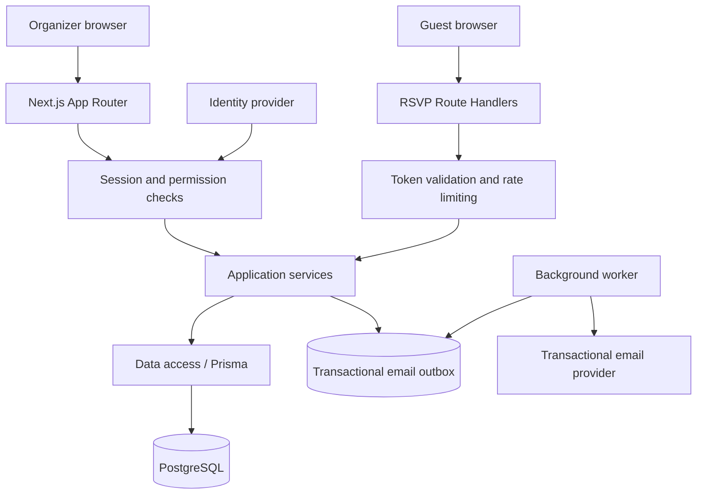
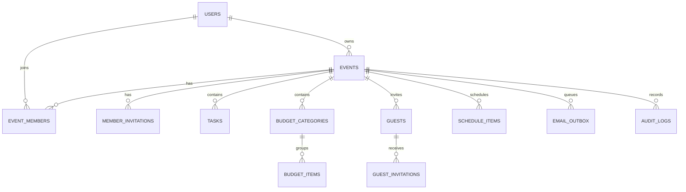

# Gatherly — Product Documentation and Architecture

Version: 1.0 · Prepared: October 31, 2026 · Status: proposed implementation blueprint

## 1. Product overview

Gatherly is a responsive event planning website for birthdays, weddings, parties, and corporate events. It brings tasks, budgets, guests, RSVPs, and the event-day schedule into one workspace.

**Technology requirements:** Next.js with TypeScript and PostgreSQL. This document specifies the system; it does not represent an implemented application.

**Assumptions:** A user may own several events and collaborate on others. Each event has one currency and one IANA time zone. Guests can RSVP without creating an account. The first release records expenses but does not collect payments or book vendors.

## 2. Scope

### First release

| Module | Capabilities |
|---|---|
| Accounts | Sign in, sign out, session management, profile |
| Events | Create, view, edit, archive, and delete owned events |
| Collaboration | Invite editors or viewers; revoke access |
| Dashboard | Task completion, budget totals, RSVP totals, upcoming tasks |
| Tasks | Create, assign, prioritize, set due dates, mark complete |
| Budget | Categories, estimated costs, recorded expenses, paid/unpaid state |
| Guests | Add invitees, set party size limits, search and filter responses |
| Invitations | Email a private RSVP link; rotate or revoke the link |
| RSVP | Accept or decline; specify party size and optional dietary notes |
| Schedule | Add ordered activities with start and end times |

### Later releases

Vendor discovery and booking, payment collection, seating plans, public event pages, reusable templates, file attachments, calendar integration, and advanced reporting. These are outside the first release.

## 3. Roles and permissions

| Operation | Owner | Editor | Viewer | Guest |
|---|---|---|---|---|
| View event planning workspace | Yes | Yes | Yes | No |
| Edit details, tasks, costs, guests, schedule | Yes | Yes | No | No |
| Invite/remove collaborators | Yes | No | No | No |
| Archive/delete event | Yes | No | No | No |
| Read invitation and update own RSVP | Via preview | Via preview | No | Valid private token |

An event's `owner_id` defines ownership. Membership rows contain only editor/viewer roles. Ownership transfer is outside the first release. Users never gain access by knowing an event or child-record ID. All server entry points enforce event permissions.

## 4. Main workflows

### Create and plan an event

1. Organizer signs in and creates an event with title, type, date/time, time zone, venue text, currency, and optional budget limit.
2. Server creates the event and default budget categories in one transaction.
3. Organizer adds collaborators, tasks, invitees, costs, and schedule activities.
4. Dashboard derives totals from current authorized records.

### Invite a collaborator

1. Owner selects an email address and editor/viewer role.
2. Server stores a hashed, expiring, single-use invitation token and queues email.
3. Recipient signs in with a verified matching email and accepts.
4. Server creates membership and consumes the token atomically. Existing membership is not duplicated.

### Invite a guest and receive an RSVP

1. Organizer creates one guest record per invitation party and sets the maximum party size.
2. Server generates a cryptographically random token, stores only its hash, and queues a private invitation link.
3. Guest opens `/rsvp/[token]`; the server returns only invitation details and that party's response.
4. Guest accepts or declines before the RSVP deadline. Accepted party size must be 1 through the party limit; declined size is 0.
5. Server locks the event row, validates capacity and deadline, and updates the response in one transaction. Capacity counts accepted people, not invitation records.
6. Organizer sees updated totals after refresh. Real-time updates are deferred.

RSVP links remain reusable until expiration or revocation so guests can change their response. Opening a link never submits a response. A repeated submission replaces the same party's response and does not create duplicates.

## 5. Functional rules

- Event states: `draft`, `planning`, `completed`, `cancelled`, `archived`. The owner controls transitions; completed/cancelled/archived events reject guest responses and planning mutations. Owners may restore an archived event to planning.
- Event end must follow start. Schedule items must fit within the event window. An RSVP deadline must be no later than event start.
- Event capacity is optional. Lowering capacity below current accepted attendance is rejected. The capacity check and RSVP update share the event lock.
- Archived events are hidden by default. Permanent deletion requires an explicit owner action and removes related event records in a transaction.
- Currency becomes immutable after budget entries exist. Store money as `numeric(14,2)` and exchange decimal strings at API boundaries; do not calculate money with binary floating point.
- Budget limit is a target, not a spending restriction. Show warnings when estimated or actual costs exceed it.
- Guest dashboard totals distinguish invitation parties, accepted people, declined parties, and pending parties.
- Store timestamps as `timestamptz`; store the event's IANA time zone separately for display and input interpretation. Show task due dates as local calendar dates.
- Shared editing uses a `version` integer on mutable records. Updates supply the last-read version; stale updates return a conflict instead of silently overwriting another edit.

## 6. System architecture

Use a modular monolith: one Next.js application, one PostgreSQL database, and a small background worker. Keep business rules in shared server-only services so UI actions and HTTP routes enforce identical rules.



### Technology decisions

| Layer | Choice | Purpose |
|---|---|---|
| Web application | Next.js App Router + TypeScript | Pages, server rendering, actions, HTTP routes |
| UI | Tailwind CSS and accessible component primitives | Responsive forms, dialogs, tables |
| Data | PostgreSQL + Prisma | Relational persistence, typed queries, migrations |
| Validation | Zod | Validate untrusted input on the server |
| Identity | Managed identity provider through its supported Next.js SDK | Verified email, sessions, account recovery |
| Email | Transactional email provider | Guest and collaborator invitations |
| Background work | PostgreSQL outbox + scheduled worker | Durable email delivery and retries |
| Testing | Vitest and Playwright | Business rules, database integration, browser flows |

Provider selection is a deployment decision. Pin mutually compatible, supported releases and commit the package lockfile during implementation; this blueprint does not assume a particular latest version.

### Next.js boundaries

- Server Components read data through authorized server-only services directly; do not call the application's own HTTP API for server-rendered reads.
- Client Components handle interactive forms, filters, dialogs, and optimistic feedback. They receive minimal serialized data.
- Server Actions handle authenticated first-party form mutations. Authenticate, authorize, and validate inside every action.
- Route Handlers expose the documented HTTP contract, public RSVP operations, and verified webhooks. Both routes and actions call the same services.
- Use the Node.js runtime for database-backed code. Keep database credentials and identity secrets in server-only modules.
- Private dashboards and RSVP pages must not use shared/public caches. After successful writes, invalidate the relevant UI data or refresh the view.
- Navigation guards improve experience but do not replace permission checks in services and data access.

## 7. Suggested source layout

```text
src/
  app/
    (marketing)/page.tsx
    (auth)/sign-in/page.tsx
    (workspace)/events/page.tsx
    (workspace)/events/new/page.tsx
    (workspace)/events/[eventId]/
      page.tsx
      tasks/page.tsx
      budget/page.tsx
      guests/page.tsx
      schedule/page.tsx
      settings/page.tsx
    rsvp/[token]/page.tsx
    invitations/[token]/page.tsx
    api/v1/...
    api/webhooks/identity/route.ts
  features/
    events/       # schemas, services, repository, actions, components
    members/
    tasks/
    budgets/
    guests/
    invitations/
    schedule/
  lib/
    auth.ts
    permissions.ts
    db.ts
    email.ts
    rate-limit.ts
    errors.ts
  workers/email-outbox.ts
prisma/
  schema.prisma
  migrations/
tests/
  integration/
  e2e/
```

## 8. PostgreSQL data model

All IDs are UUIDs. Mutable entities have `created_at`, `updated_at`, and `version`. Foreign keys and indexes must be included in migrations, not left as application conventions.

| Table | Main columns and constraints |
|---|---|
| `users` | `id`, unique `auth_subject`, `email`, `display_name`; identity provider remains the credential authority |
| `events` | `id`, `owner_id` → users, `title`, `description`, `event_type`, `status`, `starts_at`, `ends_at`, `timezone`, `venue_text`, `currency char(3)`, `budget_limit numeric(14,2)`, nullable positive `capacity`, `rsvp_deadline`; end > start; nonnegative budget |
| `event_members` | `event_id` → events, `user_id` → users, `role` editor/viewer; unique `(event_id,user_id)` |
| `member_invitations` | `id`, `event_id`, normalized `email`, `role`, unique `token_hash`, `expires_at`, `accepted_at`, `revoked_at`, `invited_by`; one active invitation per event/email enforced by transaction/index |
| `tasks` | `id`, `event_id`, `title`, `description`, `status` todo/in_progress/done, `priority` low/medium/high, nullable `assignee_id`, `due_date date`; assignee must have event access |
| `budget_categories` | `id`, `event_id`, `name`; unique `(event_id,name)` and `(event_id,id)` |
| `budget_items` | `id`, `event_id`, `category_id`, `label`, `estimated_amount numeric(14,2)`, `actual_amount numeric(14,2)`, `payment_status` unpaid/paid; amounts >= 0; composite category FK described below |
| `guests` | `id`, `event_id`, `name`, optional `email`, `party_limit`, `response` pending/accepted/declined, `party_size`, optional `dietary_notes`, `responded_at`; party_limit >= 1; pending/declined size = 0; accepted size between 1 and party_limit |
| `guest_invitations` | `id`, `event_id`, `guest_id`, unique `token_hash`, `expires_at`, `revoked_at`; at most one active token per guest |
| `schedule_items` | `id`, `event_id`, `title`, `starts_at`, `ends_at`, `location`, `notes`, `sort_order`; end > start; overlapping activities allowed |
| `email_outbox` | `id`, `event_id`, `kind`, encrypted `payload`, unique `dedupe_key`, `status`, `attempts`, `next_attempt_at`, `locked_until`, `sent_at`, sanitized `last_error` |
| `audit_logs` | `id`, `event_id`, nullable `actor_id`, `action`, `entity_type`, `entity_id`, safe `metadata`, `created_at`; exclude guest tokens and dietary notes |

### Relationships



### Integrity and access

- Child tables use `event_id` to scope every query. Cross-event references must be impossible: add unique `(event_id,id)` to referenced child tables and composite foreign keys such as budget_items `(event_id,category_id)` → budget_categories `(event_id,id)` and guest_invitations `(event_id,guest_id)` → guests `(event_id,id)`.
- Verify task assignee access inside the write transaction. Removing a collaborator unassigns that person's tasks in the same transaction.
- Use database checks for allowed states, monetary bounds, response sizes, and row-local date rules. Use transactional services for capacity, membership, and event-window checks across records.
- Index event ownership, memberships by user, tasks `(event_id,status,due_date)`, guests `(event_id,response)`, schedule `(event_id,starts_at)`, and outbox `(status,next_attempt_at)`. Token hashes are uniquely indexed.
- Event deletion cascades event-owned records, including guest personal data and queued mail. Cancel in-flight delivery where possible; already sent messages cannot be recalled. Restrict user deletion while events are owned; require transfer or event deletion first.
- Application authorization is the initial isolation boundary; the database is not exposed to browsers. PostgreSQL row-level security is an optional later defense requiring a designed per-request identity context and pooled-connection tests.

## 9. Pages and navigation

| Route | Purpose |
|---|---|
| `/` | Product introduction and sign-in entry |
| `/sign-in` | Authentication |
| `/events` | Owned/shared event list and create action |
| `/events/new` | Event creation wizard |
| `/events/[eventId]` | Planning dashboard |
| `/events/[eventId]/tasks` | Checklist and assignments |
| `/events/[eventId]/budget` | Budget limit, categories, cost entries |
| `/events/[eventId]/guests` | Invitation parties and RSVP management |
| `/events/[eventId]/schedule` | Event-day agenda |
| `/events/[eventId]/settings` | Details, collaborators, archive/delete controls |
| `/rsvp/[token]` | Private guest invitation and response form |
| `/invitations/[token]` | Sign-in and collaborator acceptance |

Support mobile layouts, keyboard navigation, visible focus, labeled controls, accessible errors, empty/loading states, and confirmation for destructive actions. Show currency and event time zone explicitly.

## 10. HTTP API contract

Base path: `/api/v1`. Protected endpoints require a valid session and event role. Reads allow owner/editor/viewer; planning writes allow owner/editor unless specified. Public means token-authorized, not unrestricted access.

| Method | Path | Behavior |
|---|---|---|
| GET, POST | `/events` | List accessible events / create owned event |
| GET, PATCH, DELETE | `/events/:eventId` | Read / update / owner-only permanent deletion |
| GET | `/events/:eventId/summary` | Derived task, cost, and RSVP totals |
| GET, POST | `/events/:eventId/tasks` | List/create tasks |
| PATCH, DELETE | `/events/:eventId/tasks/:taskId` | Update/delete task |
| GET, POST | `/events/:eventId/budget/categories` | List/create categories |
| PATCH, DELETE | `/events/:eventId/budget/categories/:categoryId` | Rename/delete; reject deletion of nonempty category |
| GET, POST | `/events/:eventId/budget/items` | List/create cost entries |
| PATCH, DELETE | `/events/:eventId/budget/items/:itemId` | Update/delete cost entry |
| GET, POST | `/events/:eventId/guests` | List/create invitation parties |
| PATCH, DELETE | `/events/:eventId/guests/:guestId` | Update/delete a party; organizer may correct RSVP |
| POST | `/events/:eventId/guests/:guestId/invitation` | Queue invitation; rotate/revoke old token when requested |
| GET, POST | `/events/:eventId/schedule` | List/create activities |
| PATCH, DELETE | `/events/:eventId/schedule/:itemId` | Update/delete activity |
| GET | `/events/:eventId/members` | List collaborators |
| POST | `/events/:eventId/member-invitations` | Owner queues collaborator invitation |
| DELETE | `/events/:eventId/member-invitations/:id` | Owner revokes pending invitation |
| PATCH, DELETE | `/events/:eventId/members/:userId` | Owner changes role/removes collaborator |
| POST | `/member-invitations/accept` | Signed-in verified recipient accepts token in body |
| GET, PATCH | `/rsvp` | Read invitation / submit response; bearer guest token |

List endpoints use cursor pagination with a default limit of 25 and maximum of 100. Allowlist filters and sort fields. Summary totals cover all matching event data, not just the current page.

Create requests return `201`; successful reads/updates return `200`; deletes return `204`. Use `400` for invalid input, `401` for missing session, `404` for unavailable or unauthorized event resources, `403` for insufficient role within an accessible event, `409` for stale versions/capacity conflicts, `410` for expired/revoked invitations, and `429` for throttling. Token errors must not expose guest details.

Example event request:

```json
{
  "title": "Company Anniversary",
  "eventType": "corporate",
  "startsAt": "2027-02-20T18:00:00+08:00",
  "endsAt": "2027-02-20T22:00:00+08:00",
  "timezone": "Asia/Manila",
  "currency": "PHP",
  "budgetLimit": "50000.00",
  "capacity": 100
}
```

Example RSVP body: `{"response":"accepted","partySize":2,"version":3}`. Send the guest token as `Authorization: Bearer …` to the RSVP API; redact it from logs. Use an error envelope such as `{"error":{"code":"CAPACITY_EXCEEDED","message":"There are not enough available places.","requestId":"…"}}`.

## 11. Security and privacy

- Verify sessions through the identity SDK and map the immutable identity subject to the local user. Do not trust client-supplied user IDs or roles.
- Validate every mutation on the server, use parameterized database queries, and constrain request body sizes.
- Generate at least 32 random bytes for invitation tokens. Store hashes; apply expiration and revocation. Treat a guest link as a secret granting access to that party only.
- RSVP pages use `noindex`, `Cache-Control: no-store`, and `Referrer-Policy: no-referrer`. Omit third-party analytics there. Redact token-bearing paths from proxy and application logs.
- Protect cookie-authenticated HTTP mutations against CSRF with verified origin plus the chosen session framework's protection. Check authorization inside Server Actions regardless of route guards.
- Rate-limit invitation sending and RSVP attempts using a shared persistent store or hosting platform control; process-local counters are insufficient across instances.
- Email jobs need a temporary encrypted copy of the raw invitation link because only a hash is retained in invitation tables. Restrict decryption to the worker and erase the payload after delivery or terminal failure.
- Collect dietary notes only when needed; disclose their purpose and make them optional. Restrict access to event planners, support guest/event deletion, and document retention before launch. Proposed default: remove guest contact details and dietary notes 90 days after event end, with advance organizer notice.
- Keep secrets outside source control. Use separate development/staging/production identities and databases; do not use real guest data in test environments.

## 12. Delivery reliability and concurrency

Queue invitations in the same database transaction as invitation creation. Worker leases due outbox rows using `FOR UPDATE SKIP LOCKED`, commits the lease, sends outside the transaction, then records the result. Reclaim expired leases after crashes.

Retry transient delivery failures with exponential backoff and a maximum attempt count; surface terminal failures to the organizer. Use provider idempotency keys when supported. Delivery is at least once; a crash after send may cause a duplicate email, so messages and RSVP links must remain safe to reuse.

Before sending, recheck that the event and invitation are still active. Rate-limit resends and allow only one pending delivery per invitation deduplication key. A sent email is not proof of delivery or response.

## 13. Deployment and operations

```text
Browser → HTTPS → Next.js hosting (Node.js runtime)
                         → pooled PostgreSQL connection
Scheduled trigger → email worker → email provider
Identity provider → verified webhook → local user synchronization
```

Deploy Next.js to a Node.js-capable platform and use managed PostgreSQL in a nearby region. Run the worker on a scheduled job platform; do not rely on a response completing background work. Use a pooled runtime connection and a provider-supported migration connection. Keep connection counts within database limits.

Minimum configuration: database runtime/migration URLs, identity credentials, email credentials, application URL, outbox encryption key, and worker trigger secret. Public configuration contains no secrets.

Release sequence: install pinned dependencies, lint, type-check, run unit/integration tests, build, apply reviewed backward-compatible migrations once, deploy application and worker, then run smoke tests. Use expand/contract migrations when changing existing data structures; rollback app code only while the schema remains compatible.

Enable automated backups and point-in-time recovery where supported; test restoration into an isolated database before launch. Monitor request errors/latency, database connections, authorization failures, worker backlog age, and email failures. Logs include request IDs and omit tokens, email bodies, and sensitive guest notes.

Initial performance targets, to validate under an agreed test load: event pages usable within 2.5 seconds on a typical mobile connection; p95 API reads below 500 ms excluding external identity/email calls; invitation jobs normally start within two minutes. These are targets, not measured results.

## 14. Verification and acceptance criteria

| Area | Required evidence |
|---|---|
| Isolation | User A cannot read or mutate user B's event or child records by changing IDs; mismatched event/category/guest references fail |
| Permissions | Viewer writes fail; editor cannot manage collaborators or delete the event; revoked access fails immediately |
| Tasks | Authorized assignment succeeds; removed collaborators are unassigned atomically |
| Budget | Exact decimal totals, nonnegative constraints, empty-state handling, overspend indication |
| RSVP | Accepted/declined rules, invalid/expired/revoked token handling, deadline enforcement, no response on GET |
| Capacity | Two concurrent responses competing for the last place cannot both exceed capacity; repeated response does not double-count |
| Concurrency | Stale versions produce a clear conflict and preserve newer edits |
| Email | Failed delivery retries, expired worker leases recover, duplicate sends do not create duplicate guests |
| Lifecycle | Archived/cancelled event rejects responses; permanent deletion removes associated guest data |
| UX | Mobile planning and RSVP flows work with keyboard navigation and readable form errors |

Use unit tests for money, state transitions, validation, and permissions; integration tests against real PostgreSQL for constraints, transactions, isolation, and concurrent RSVP; browser tests for event creation through guest response. Mock external email/identity boundaries in automated tests and smoke-test actual integrations in staging.

## 15. Implementation phases

1. **Foundation:** Next.js skeleton, identity integration, PostgreSQL/Prisma migrations, shared validation/errors, protected workspace. Done when sign-in and event isolation tests pass.
2. **Core planning:** Event management, tasks, budget, derived dashboard. Done when a user can plan an event and totals remain accurate.
3. **Guests and invitations:** Guest parties, private RSVP, deadlines/capacity, durable email delivery. Done when the invitation-to-response browser flow and concurrency tests pass.
4. **Collaboration and schedule:** Verified collaborator acceptance, roles, assignment cleanup, event timeline. Done when role and schedule checks pass.
5. **Launch preparation:** Accessibility review, privacy/retention settings, migration rehearsal, restore drill, monitoring, staging smoke test. Done when launch acceptance criteria have evidence.

## 16. Architecture decisions and open choices

- Start with a modular monolith to keep deployment and transactions simple. Split services only when a measured operational need appears.
- PostgreSQL is the source of truth. Derive dashboard totals first; add caching only after profiling with safe invalidation.
- Use an outbox instead of sending emails inside request transactions to survive provider delays and failures.
- Choose identity, email, and hosting providers before implementation. Confirm expected peak event sizes, retention expectations, and whether editor access to dietary notes is appropriate for the intended users.
- Payment processing, public discovery, vendor accounts, and real-time collaboration require separate design work before entering scope.

## 17. Official implementation references

- [Next.js authentication guide](https://nextjs.org/docs/app/guides/authentication): authentication and authorization boundaries.
- [Next.js mutating data guide](https://nextjs.org/docs/app/getting-started/mutating-data): Server Functions and authorization at mutation entry points.
- [Next.js use server reference](https://nextjs.org/docs/app/api-reference/directives/use-server): server-side code boundaries and security considerations.
- [PostgreSQL row security policies](https://www.postgresql.org/docs/17/ddl-rowsecurity.html): optional database isolation and policy behavior.

The product model and deployment choices above are proposed architecture decisions, rather than requirements imposed by these references.
